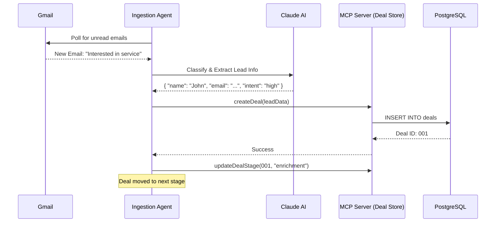
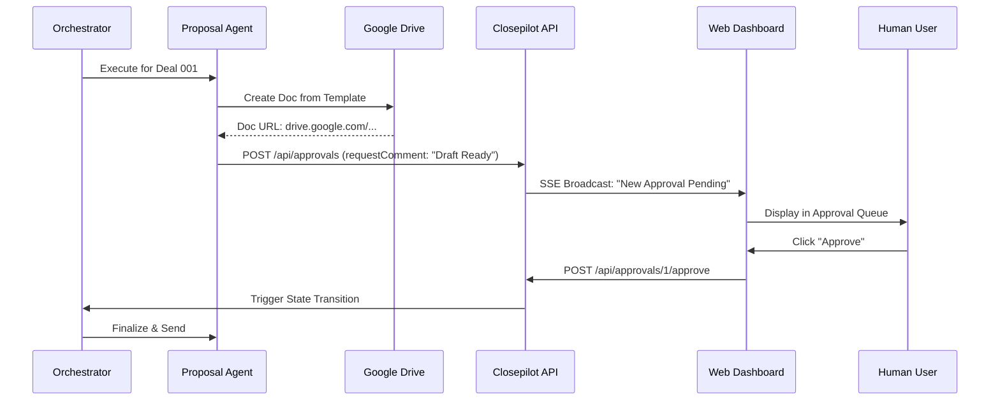
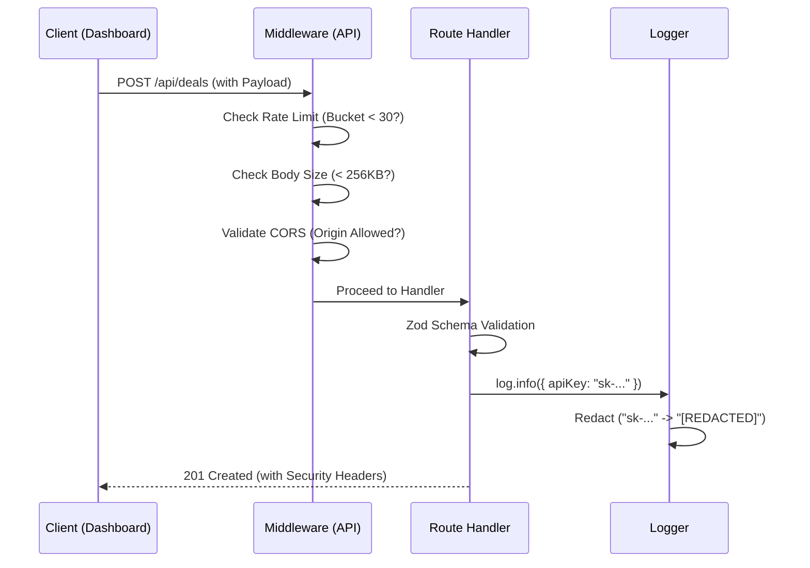

# Closepilot Workflow Sequence Diagrams

## 1. Lead Ingestion & Qualification
This workflow describes how a new email inquiry becomes a qualified deal in the system.

## 2. Proposal Generation & Approval
Critical actions like proposal delivery require human oversight.

## 3. Production Hardening Flow (Internal)
How the system handles a request with security measures active.

